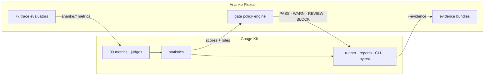
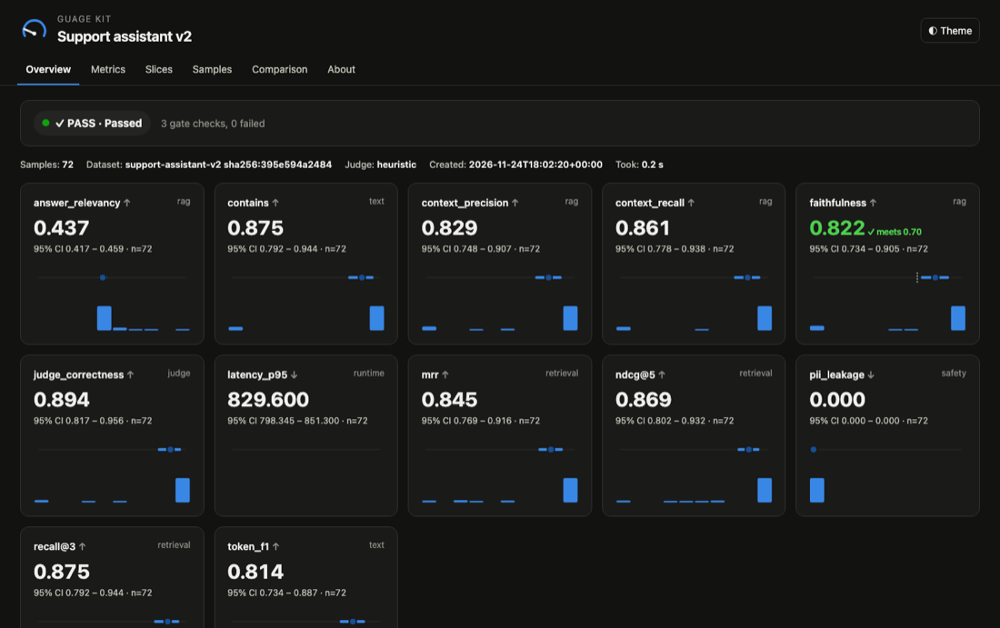
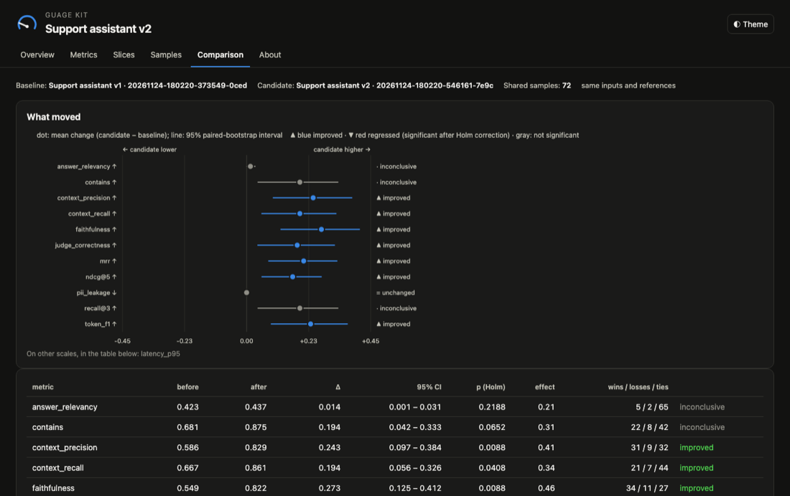
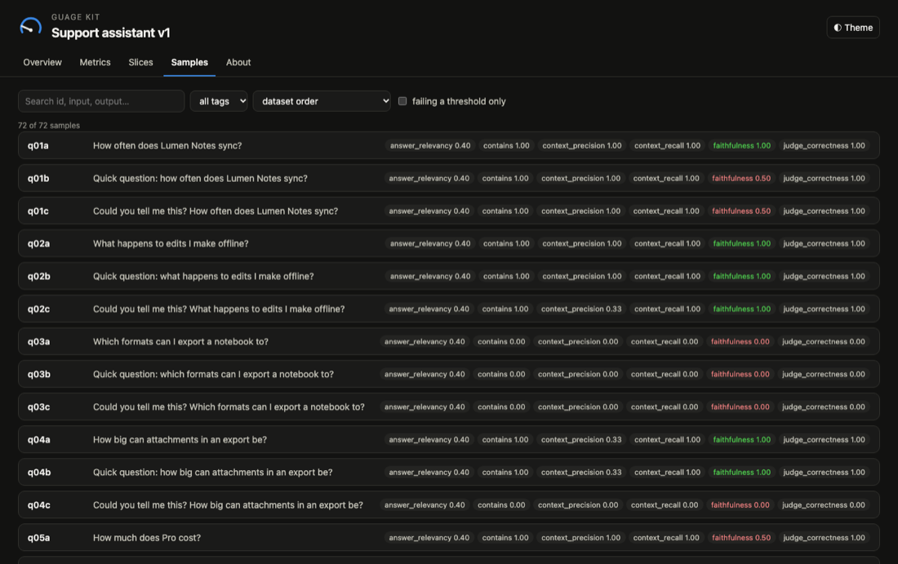
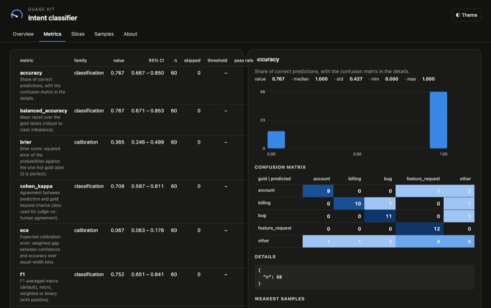

<div align="center">

<picture>
  <source media="(prefers-color-scheme: light)" srcset="assets/readme/hero-light.svg" />
  
</picture>

# Guage Kit

### *Know how good it is, with the error bars to prove it.*

An evaluation toolkit for **LLMs, RAG pipelines, retrieval, embeddings, classifiers and agents**. Point it at a
dataset (and, if you like, at your system): it scores every sample with **167 metrics**, puts a **95% confidence
interval** on every number, tells you **what really changed** between two versions, gates your CI, and writes **one
offline HTML report** you can open anywhere. Built on the [Ananke Plexus](https://neo-pragnya.github.io/Ananke-Plexus/)
evaluation harness.

[](https://pypi.org/project/guage-kit/)
[](https://pypi.org/project/guage-kit/)
[](LICENSE)
[](https://github.com/Neo-Pragnya/Guage-Kit/actions/workflows/ci.yml)
[](https://neo-pragnya.github.io/Guage-Kit/)
[](acceptance/README.md)

[**📖 Docs**](https://neo-pragnya.github.io/Guage-Kit/) ·
[**📏 Metric reference**](https://neo-pragnya.github.io/Guage-Kit/docs/reference/metrics/) ·
[**🖼️ Live reports**](https://neo-pragnya.github.io/Guage-Kit/demo/support-assistant-v1-vs-v2.html) ·
[**🐍 PyPI**](https://pypi.org/project/guage-kit/) ·
[**📝 Changelog**](CHANGELOG.md) ·
[**🗺️ Roadmap**](docs/roadmap.md)

</div>

> [!NOTE]
> The built-in RAG and safety metrics are **deterministic heuristics**: claims are checked lexically against the
> retrieved text, and refusals and personal data are found by patterns. They are fast, free and reproducible, and each
> [metric's page](https://neo-pragnya.github.io/Guage-Kit/docs/reference/metrics/) says exactly how it works and where
> it misleads. Add an **LLM judge** when you need semantic judgement. Nothing leaves your machine unless you choose a
> model as a judge or as the system under test.

---

## 📚 Contents

<table>
<tr>
<td valign="top">

**Start here**
- [✨ Why Guage Kit?](#-why-guage-kit)
- [⚡ Quick start](#-quick-start)
- [🧪 Did version 2 really get better?](#-did-version-2-really-get-better)
- [🧭 How it works](#-how-it-works)

</td>
<td valign="top">

**What it does**
- [📏 What it measures](#-what-it-measures)
- [📐 The statistics, written down](#-the-statistics-written-down)
- [🐍 Python cookbook](#-python-cookbook)
- [🧷 In pytest and in CI](#-in-pytest-and-in-ci)
- [🖼️ Gallery](#️-gallery)

</td>
<td valign="top">

**Trust and reference**
- [🛡️ Guarantees](#️-guarantees)
- [📋 Reference](#-reference)
- [❓ FAQ](#-faq)
- [🛠️ Development](#️-development)
- [📄 Licence](#-licence)

</td>
</tr>
</table>

## ✨ Why Guage Kit?

| | |
| --- | --- |
| 📏 **Everything in one place** | Text overlap, RAG grounding, retrieval ranking, classification and calibration, embedding models, structured output, safety, agents' tool use, latency and cost: **90 native metrics** plus **77 agent-trace evaluators** from Ananke Plexus. |
| 📊 **Numbers you can trust** | Every value comes with a **bootstrap confidence interval**. Comparisons are **paired**, tested with a permutation test and **Holm-corrected** for testing many metrics at once, so "improved" means improved. |
| 🧾 **Explained, not just scored** | Each sample shows which claims were unsupported, which tool call was wrong, which threshold it missed. Each metric has a [full write-up](https://neo-pragnya.github.io/Guage-Kit/docs/reference/metrics/) with its formula, pitfalls and papers. |
| 🔌 **Offline first** | All 90 native metrics run with **no model and no network**. BLEU, chrF and ROUGE match sacreBLEU and rouge-score exactly; classification matches scikit-learn. |
| ⚖️ **Judges when you want them** | 11 anchored criteria or your own rubric, on **Claude**, OpenAI-compatible servers, Ollama, Bedrock or any function: cached, run in both orders for pairwise comparisons, calibrated against your human labels. |
| 🚦 **Made for CI** | `min`/`max`/`max_drop` gates decided by Ananke Plexus's policy engine into **PASS · WARN · REVIEW · BLOCK**, with exit codes, JUnit XML, Markdown summaries and a pytest plugin. |

## ⚡ Quick start

```bash
pip install guage-kit
guage init        # a starter guage.yaml and a sample dataset (never overwrites)
guage run         # evaluate, gate, write reports; exits 1 when the gate blocks
guage demo        # or: three systems evaluated offline, with their reports
```

<p align="center"></p>

Open `reports/guage-report.html`: an overview with every metric and its interval, distributions, slices, every
sample with its explanations, and the gate's decision. [See a live one.](https://neo-pragnya.github.io/Guage-Kit/demo/support-assistant-v1.html)

## 🧪 Did version 2 really get better?

Two runs on the same samples are compared **pair by pair**: the mean difference, its 95% interval and a permutation
test, corrected with Holm's method because a dozen metrics are tested at once. A difference that could be noise is
reported as **inconclusive**, not as an improvement.

<p align="center"></p>

```bash
guage baseline set                                   # remember this run as baseline:main
guage run --baseline baseline:main                   # compare every run with it
guage compare baseline:main latest -o compare.html   # the comparison as a report
```

## 🧭 How it works

<p align="center"></p>

Guage Kit is the evaluation product; [Ananke Plexus](https://neo-pragnya.github.io/Ananke-Plexus/) is the harness
underneath, and each owns its part:



## 📏 What it measures

Every family links to its reference page, where each metric has its method, formula, parameters, how to read it,
pitfalls, a worked example (run by the test suite) and its papers. `guage metrics show <name>` prints the same.

<!-- FAMILIES:START -->
| | family | metrics | what it covers |
| --- | --- | ---: | --- |
| 📝 | [**Text**](https://neo-pragnya.github.io/Guage-Kit/docs/reference/metrics/text/) | 25 | exact and normalised match, token F1, BLEU, chrF, ROUGE, edit distance, numbers, length, readability, diversity |
| 🧠 | [**Semantic**](https://neo-pragnya.github.io/Guage-Kit/docs/reference/metrics/semantic/) | 2 | embedding similarity, BERTScore-style token matching |
| 📚 | [**RAG**](https://neo-pragnya.github.io/Guage-Kit/docs/reference/metrics/rag/) | 10 | faithfulness, hallucination rate, context precision, recall, relevance and use, answer relevancy and correctness, citations |
| 🔎 | [**Retrieval**](https://neo-pragnya.github.io/Guage-Kit/docs/reference/metrics/retrieval/) | 7 | precision@k, recall@k, hit rate, MRR, MAP, nDCG (binary or graded), R-precision |
| 🏷️ | [**Classification**](https://neo-pragnya.github.io/Guage-Kit/docs/reference/metrics/classification/) | 8 | accuracy, balanced accuracy, precision, recall, F1, Cohen's kappa, MCC |
| 🎯 | [**Calibration**](https://neo-pragnya.github.io/Guage-Kit/docs/reference/metrics/calibration/) | 4 | ECE, MCE, Brier score, selective AUROC |
| 🧭 | [**Embedding models**](https://neo-pragnya.github.io/Guage-Kit/docs/reference/metrics/embeddings/) | 6 | STS Spearman and Pearson, alignment, uniformity, anisotropy |
| 🧱 | [**Structured output**](https://neo-pragnya.github.io/Guage-Kit/docs/reference/metrics/structured/) | 6 | valid JSON or YAML, JSON Schema, field-level accuracy, Python that parses |
| 🛡️ | [**Safety**](https://neo-pragnya.github.io/Guage-Kit/docs/reference/metrics/safety/) | 8 | refusal and over-refusal, personal data, secrets, prompt injection, system-prompt leakage, toxicity, fairness |
| 🤖 | [**Agents**](https://neo-pragnya.github.io/Guage-Kit/docs/reference/metrics/agent/) | 7 | tool-call F1, argument accuracy, sequence match, error and redundancy rates, goal success |
| ⏱️ | [**Runtime**](https://neo-pragnya.github.io/Guage-Kit/docs/reference/metrics/runtime/) | 6 | latency percentiles, tokens, cost |
| ⚖️ | [**LLM judge**](https://neo-pragnya.github.io/Guage-Kit/docs/reference/metrics/judge/) | 1 | a judge's grade on one of 11 criteria or your own rubric |
| 🧬 | [**Ananke Plexus evaluators**](https://neo-pragnya.github.io/Guage-Kit/docs/reference/metrics/ananke/) | 77 | agent traces: outcome, trajectory, tool use, planning, retrieval, safety, resilience, efficiency, multi-agent, architecture |
| | **Total** | **167** | |
<!-- FAMILIES:END -->

## 📐 The statistics, written down

A run value is the mean of the per-sample scores $s_1, \dots, s_n$ (or a corpus statistic such as BLEU). Its 95%
interval is the percentile bootstrap: resample the samples $B$ times (fixed seed, so reports are reproducible),
recompute, and take the 2.5th and 97.5th percentiles.

```math
\hat\theta = \frac{1}{n}\sum_{i=1}^{n} s_i, \qquad
\mathrm{CI}_{95\%} = \left[\hat\theta^{*}_{(0.025)},\ \hat\theta^{*}_{(0.975)}\right], \quad
\hat\theta^{*}_{b} = \frac{1}{n}\sum_{i=1}^{n} s_{j_{b,i}},\ j_{b,i} \sim \mathcal{U}\{1..n\}
```

Comparing versions $A$ and $B$ uses the paired differences $d_i = s^{B}_i - s^{A}_i$. The permutation test flips
their signs (all $2^n$ ways when that is small, otherwise 10,000 random ways); with $m$ metrics, Holm's step-down
correction multiplies the $k$-th smallest p-value by $m - k + 1$:

```math
p = \frac{\#\{\sigma : |\bar d_\sigma| \ge |\bar d|\}}{\#\sigma}, \qquad
p^{\mathrm{Holm}}_{(k)} = \max_{j \le k} \min\!\left(1,\ (m - j + 1)\, p_{(j)}\right)
```

Effect sizes (paired Cohen's *d*), sign and Wilcoxon tests and sample-size planning are in
[statistical methods](https://neo-pragnya.github.io/Guage-Kit/docs/reference/api/statistical-methods/), each with
the paper behind it.

## 🐍 Python cookbook

Every example below was run against guage-kit 0.1.1; the comments are its real output.

**Score outputs you already have**

```python
import guage_kit as gk

samples = [
    {"id": "1", "input": "How often does it sync?", "output": "Every five minutes.", "expected": "It syncs every five minutes."},
    {"id": "2", "input": "Can I export to PDF?", "output": "Yes, from the File menu.", "expected": "Yes: File → Export → PDF."},
    {"id": "3", "input": "Is there a free plan?", "output": "No.", "expected": "Yes, the Basic plan is free."},
]
run = gk.evaluate(samples, ["token_f1", "rougeL", "exact_match"])
for name, s in run.summaries.items():
    print(name, round(s.value, 3), (round(s.ci_low, 3), round(s.ci_high, 3)))
# token_f1 0.383 (0.133, 0.75)
# rougeL 0.398 (0.148, 0.75)
# exact_match 0.0 (0.0, 0.0)
```

**Catch an invented claim in a RAG answer**

```python
rag = {"id": "r1", "input": "When was the tower finished?",
       "output": "The tower was completed in 1889 [1]. It is 330 metres tall [1].",
       "contexts": ["The Eiffel Tower was completed in 1889 for the World's Fair."],
       "retrieved_ids": ["eiffel", "louvre"], "relevant_ids": ["eiffel"]}
run = gk.evaluate([rag], ["faithfulness", "hallucination_rate", "citation_accuracy", "recall@1", "mrr"])
print({k: round(v.value, 3) for k, v in run.summaries.items()})
# {'faithfulness': 0.5, 'hallucination_rate': 0.5, 'citation_accuracy': 0.5, 'recall@1': 1.0, 'mrr': 1.0}
print(run.samples[0].scores["faithfulness"].details["unsupported"])
# ['It is 330 metres tall.']
```

**Evaluate your own system, with a gate and a report**

```python
DOCS = {
    "sync": "Notes sync every five minutes over an encrypted connection.",
    "export": "You can export a notebook to PDF or Markdown from the File menu.",
    "plans": "The Basic plan is free; Pro costs 8 dollars a month.",
}

def my_rag(question: str) -> dict:                      # your system under test
    words = set(question.lower().split())
    top = sorted(DOCS, key=lambda d: -len(words & set(DOCS[d].lower().split())))[:2]
    return {"output": DOCS[top[0]], "contexts": [DOCS[d] for d in top], "retrieved_ids": top}

data = [
    {"id": "q1", "input": "How often do notes sync?", "expected": "Every five minutes.", "relevant_ids": ["sync"]},
    {"id": "q2", "input": "Can I export a notebook to PDF?", "expected": "Yes, to PDF or Markdown.", "relevant_ids": ["export"]},
    {"id": "q3", "input": "Is the Basic plan free?", "expected": "Yes, Basic is free.", "relevant_ids": ["plans"]},
]
run = gk.evaluate(data, ["faithfulness", "answer_correctness", "recall@1", "mrr"], target=my_rag,
                  gates=[{"metric": "faithfulness", "min": 0.85}])
print(run.gate.verdict, {k: round(v.value, 3) for k, v in run.summaries.items()})
# PASS {'faithfulness': 1.0, 'answer_correctness': 0.667, 'recall@1': 1.0, 'mrr': 1.0}
gk.report(run, "report.html")                           # one offline file
```

**Gate on a threshold, compare two versions, add your own metric**

```python
run = gk.evaluate(samples, ["token_f1"], gates=[{"metric": "token_f1", "min": 0.5, "on_fail": "warn"}])
print(run.gate.verdict, run.gate.checks[0].message)
# WARN 0.3833 misses ≥ 0.5

v2 = [dict(s, output=s["expected"]) for s in samples]
c = gk.compare(gk.evaluate(samples, ["token_f1"]), gk.evaluate(v2, ["token_f1"]))
d = c.metrics["token_f1"]
print(round(d.delta, 3), d.direction, d.n)
# 0.617 inconclusive 3          ← a big jump, but three samples cannot prove it

@gk.metric("mentions_menu", family="text", requires=("output",))
def mentions_menu(sample, *, word="menu"):
    """1 when the output points to a menu."""
    return float(word in sample.output_text.lower())

print(gk.evaluate(samples, ["mentions_menu"]).value("mentions_menu"))
# 0.3333333333333333
```

**Grade with a judge**: `judge="heuristic"` works offline; `judge="anthropic:claude-opus-5-5"` (with
`pip install "guage-kit[anthropic]"`) uses Claude, and `openai:`, `ollama:`, `bedrock:` and `python:` specs work the
same way. See [judges](https://neo-pragnya.github.io/Guage-Kit/docs/guides/judges/) and the
[criteria](https://neo-pragnya.github.io/Guage-Kit/docs/reference/api/criteria/).

## 🧷 In pytest and in CI

The pytest plugin gives every test a `guage` fixture:

```python
import guage_kit as gk


def test_support_answers(guage):
    data = [gk.Sample(id="1", input="Capital of France?", output="Paris.", expected="Paris"),
            gk.Sample(id="2", input="Largest ocean?", output="The Pacific.", expected="Pacific")]
    run = guage.evaluate(data, ["contains", "token_f1"])
    guage.check(run, contains=1.0, token_f1=0.5)


def test_grounded(guage):
    guage.assert_metric("faithfulness", "Water boils at 100 degrees Celsius.",
                        contexts=["At sea level water boils at 100 degrees Celsius."], minimum=0.8)
```

```text
$ pytest --guage-report reports/
================================== Guage Kit ===================================
test_answers.py::test_support_answers: – · contains=1.000, token_f1=1.000
2 passed in 0.03s
```

In CI, `guage run` exits **0** on PASS (or WARN, REVIEW), **1** when the gate blocks, and **2** on a usage or `GK-*`
error. A `guage.yaml` holds the suite:

```yaml
name: support-assistant
dataset: data/support.jsonl
target: my_app.rag:answer            # optional: your system under test
judge: anthropic:claude-opus-5-5     # optional: "heuristic" stays offline
metrics: auto                        # or a list, with params and thresholds
gates:
  - {metric: faithfulness, min: 0.85}
  - {metric: recall@5, min: 0.8, on_fail: warn}
  - {metric: token_f1, max_drop: 0.02}           # versus the baseline
baseline: baseline:main
reports: {html: reports/guage-report.html, junit: reports/guage-junit.xml, markdown: reports/guage-summary.md}
```

A complete GitHub Actions workflow (judge cache, step summary, artifacts) is in
[gates and CI](https://neo-pragnya.github.io/Guage-Kit/docs/guides/gates-and-ci/).

## 🖼️ Gallery

Every report is one self-contained HTML file. These are the `guage demo` reports, live on the docs site:

<table>
<tr>
<td width="50%" valign="top"><a href="https://neo-pragnya.github.io/Guage-Kit/demo/support-assistant-v1-vs-v2.html#overview"></a><br><b>Overview</b><br><sub>Every metric with its interval and distribution, and the gate's verdict.</sub></td>
<td width="50%" valign="top"><a href="https://neo-pragnya.github.io/Guage-Kit/demo/support-assistant-v1-vs-v2.html#compare"></a><br><b>Paired comparison</b><br><sub>What moved, with intervals and Holm-corrected p-values.</sub></td>
</tr>
<tr>
<td width="50%" valign="top"><a href="https://neo-pragnya.github.io/Guage-Kit/demo/support-assistant-v1.html#samples"></a><br><b>Every sample, explained</b><br><sub>Search, filter by tag, open a sample to see unsupported claims.</sub></td>
<td width="50%" valign="top"><a href="https://neo-pragnya.github.io/Guage-Kit/demo/intent-classifier.html#metrics"></a><br><b>Classifiers and calibration</b><br><sub>Confusion matrix, F1, kappa, MCC, ECE and a reliability diagram.</sub></td>
</tr>
</table>

## 🛡️ Guarantees

| Guarantee | How it is enforced |
| --- | --- |
| Documented numbers are real | Every worked example on the [metric pages](https://neo-pragnya.github.io/Guage-Kit/docs/reference/metrics/) is run against the metric by `tests/test_metric_cards.py`. |
| Text metrics match their references | Parity tests against sacreBLEU (BLEU, chrF, chrF++), rouge-score (ROUGE), scikit-learn and SciPy. |
| Reports are safe to open and share | A strict Content-Security-Policy with hashed inline code, text inserted as text only, and a `public` profile that removes sample text. |
| A missing value never passes a gate | A rule whose metric has no value raises the verdict to the rule's own level, with a note in the run. |
| Reproducible | Fixed seeds for every resample, dataset fingerprints, and the environment (versions, git commit) recorded in each run. |
| What ships works | 47 capability scenarios drive the real CLI from the built wheel in a fresh environment before every release ([release gate](acceptance/README.md)). |
| Safe to install | Every runtime dependency is permissively licensed (checked in CI); the wheel and sdist are scanned for secrets, vulnerable dependencies and suspicious code before upload. |
| The docs cannot drift | The metric reference, the API reference and this README's tables are generated from the code; CI fails when they are stale. |

## 📋 Reference

<details>
<summary><b>⌨️ Every command</b></summary>

<!-- CLI:START -->
| command | what it does |
| --- | --- |
| `guage baseline set` | Copy a run to .guage/baselines/&lt;name>.json (use it as baseline:&lt;name>). |
| `guage baseline show` | Print a baseline's metrics. |
| `guage compare` | Compare two runs with paired statistics (bootstrap CI, permutation test, Holm correction). |
| `guage data convert` | Convert between .jsonl, .json, .yaml and .csv (field aliases are normalised). |
| `guage data sample` | Write a reproducible random sample of n records. |
| `guage data split` | Split into &lt;name>.a.jsonl and &lt;name>.b.jsonl (for dev/test or train/holdout). |
| `guage data stats` | Field coverage, tags and lengths, and the metrics `auto` would choose. |
| `guage data validate` | Load a dataset and report problems (exit 2 on the first invalid record). |
| `guage demo` | Evaluate three demo systems offline and write their reports (no model, no network). |
| `guage doctor` | Check the Ananke harness, optional extras and provider credentials (names only, never values). |
| `guage init` | Write a starter guage.yaml and data/sample.jsonl (never overwrites). |
| `guage judge calibrate` | Grade labelled samples with a judge and report agreement with the human grades. |
| `guage metrics list` | List every metric with its family and required fields. |
| `guage metrics show` | Show one metric: its declaration, what it measures, how it is computed, pitfalls and references. |
| `guage probe perturb` | Write perturbed variants of a dataset's inputs (and contexts) for robustness runs. |
| `guage probe redteam` | Write a red-team dataset (prompt injection, extraction, PII, over-refusal). Run it with --target. |
| `guage probe robustness` | Run a target on originals and perturbed inputs; report output agreement and metric drops. |
| `guage report` | Render the HTML report of a saved run. |
| `guage run` | Run an evaluation from a suite file or from flags, gate it and write reports. |
| `guage runs` | List saved runs (newest first). |
| `guage synth` | Generate a test set from your own documents. |
| `guage version` | Print the Guage Kit and Ananke Plexus versions. |
<!-- CLI:END -->

Every option of every command: [CLI options](https://neo-pragnya.github.io/Guage-Kit/docs/reference/api/cli-options/).

</details>

<details>
<summary><b>🚨 Error codes</b></summary>

Every expected failure raises `GuageError` with a stable code and a hint; the CLI prints it and exits 2.

<!-- ERRORS:START -->
| code | meaning |
| --- | --- |
| `GK-DATA-001` | dataset file not found |
| `GK-DATA-002` | unsupported dataset format |
| `GK-DATA-003` | invalid sample in dataset |
| `GK-DATA-004` | dataset is empty |
| `GK-METRIC-001` | unknown metric |
| `GK-METRIC-002` | invalid metric parameters |
| `GK-METRIC-003` | metric needs an optional extra that is not installed |
| `GK-TARGET-001` | target could not be imported |
| `GK-TARGET-002` | target call failed |
| `GK-JUDGE-001` | judge provider is not configured |
| `GK-JUDGE-002` | judge returned an unparseable verdict |
| `GK-JUDGE-003` | judge provider call failed |
| `GK-CONFIG-001` | invalid suite configuration |
| `GK-RUN-001` | run not found |
| `GK-RUN-002` | runs cannot be compared |
| `GK-HARNESS-001` | installed Ananke Plexus is outside the supported range |
| `GK-HARNESS-002` | unknown Ananke evaluator |
| `GK-REPORT-001` | report could not be written |
<!-- ERRORS:END -->

</details>

<details>
<summary><b>📦 Extras</b></summary>

```bash
pip install guage-kit                    # core: offline metrics, reports, CLI, pytest plugin
pip install "guage-kit[anthropic]"       # Claude judges and targets (official SDK)
pip install "guage-kit[embeddings]"      # sentence-transformers for semantic metrics
pip install "guage-kit[jsonschema]"      # full JSON Schema validation
pip install "guage-kit[bedrock]"         # Amazon Bedrock judges and targets
pip install "guage-kit[all]"             # all of the above
```

</details>

**Documentation:** [getting started](https://neo-pragnya.github.io/Guage-Kit/docs/guides/getting-started/) ·
[datasets](https://neo-pragnya.github.io/Guage-Kit/docs/guides/datasets/) ·
[RAG](https://neo-pragnya.github.io/Guage-Kit/docs/guides/rag/) ·
[agents](https://neo-pragnya.github.io/Guage-Kit/docs/guides/agents/) ·
[judges](https://neo-pragnya.github.io/Guage-Kit/docs/guides/judges/) ·
[statistics](https://neo-pragnya.github.io/Guage-Kit/docs/guides/statistics/) ·
[safety and red teaming](https://neo-pragnya.github.io/Guage-Kit/docs/guides/safety-and-red-teaming/) ·
[robustness](https://neo-pragnya.github.io/Guage-Kit/docs/guides/robustness/) ·
[synthetic test sets](https://neo-pragnya.github.io/Guage-Kit/docs/guides/synthetic-data/) ·
[Python API](https://neo-pragnya.github.io/Guage-Kit/docs/reference/api/) ·
[configuration](https://neo-pragnya.github.io/Guage-Kit/docs/reference/configuration/)

## ❓ FAQ

<details>
<summary><b>Do I need an API key or a GPU?</b></summary>

No. All 90 native metrics, the statistics, gates and reports run offline on a laptop. You need a key only if you
choose a model as a judge (`judge: anthropic:…`) or as the system under test.

</details>

<details>
<summary><b>How is "faithfulness" computed without a model?</b></summary>

The answer is split into claims, and each claim's content words and numbers are checked against the retrieved
contexts; a claim below the support threshold is unsupported. It catches invented numbers, names and details well and
misses paraphrased support. With a judge configured, `{name: faithfulness, params: {method: judge}}` has the judge
check each claim instead ([details](https://neo-pragnya.github.io/Guage-Kit/docs/reference/metrics/rag/#faithfulness)).

</details>

<details>
<summary><b>How many samples do I need?</b></summary>

Enough for the intervals to be narrower than the change you care about. `guage_kit.stats.samples_needed(effect,
sd_diff)` gives the number for a paired comparison; as a rule of thumb, a few dozen samples detect large changes and
a few hundred detect small ones. The report shows each interval, so you can see when a dataset is too small.

</details>

<details>
<summary><b>Where do the Ananke evaluators come from?</b></summary>

From the installed `ananke-plexus` package. Guage Kit discovers them, fills their arguments from your samples, and
runs them on each sample's agent trace (recorded, or built from its tool calls). Each has a page in the
[metric reference](https://neo-pragnya.github.io/Guage-Kit/docs/reference/metrics/ananke/).

</details>

<details>
<summary><b>Why "Guage" and not "Gauge"?</b></summary>

It is the project's name. The package is `guage-kit`, the import is `guage_kit` and the command is `guage`.

</details>

## 🛠️ Development

```bash
make install         # uv sync with the dev tools
make verify          # ruff, format, mypy --strict, tests, licences, generated docs and README checks
make acceptance      # 47 capability scenarios against the real CLI (the release gate)
make docs-generate   # metric and API references, the README's generated sections and its PyPI copy
make scan            # build and scan the wheel and sdist the way package firewalls do
```

See [CONTRIBUTING.md](CONTRIBUTING.md), [AGENTS.md](AGENTS.md) and the [release guide](docs/guides/release.md).

## 📄 Licence

[Apache-2.0](LICENSE). Every runtime dependency is permissively licensed (Apache-2.0, MIT, BSD, ISC, PSF; certifi is
MPL-2.0, used unmodified); see [licensing](docs/concepts/licensing.md).
