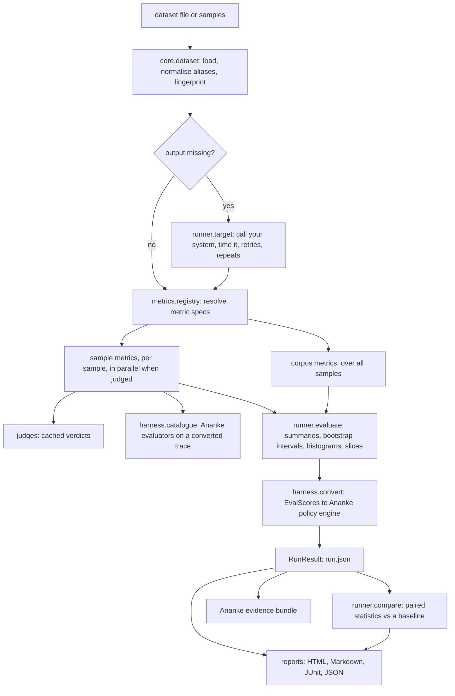

# Architecture

## The boundary

Guage Kit is a client of Ananke Plexus, in the same way as other products built on the harness.

| Ananke Plexus owns | Guage Kit owns |
| --- | --- |
| the canonical evaluation model: `EvalCase`, `AgentTrace` (spans, usage), `EvalScore`, `EvalReport` | the sample, dataset and run model that metrics and reports work with |
| 77 agent-trace evaluators across trajectory, tool use, planning, safety, resilience, efficiency, multi-agent, outcome, retrieval and architecture | the metric library: text, RAG, retrieval, classification, calibration, embeddings, structured output, safety, agents, runtime |
| trace normalisation (OpenTelemetry-style spans to `AgentTrace`) | judges, providers, criteria and judge calibration |
| the gate policy engine (`apply_gate_policy`: scores and rules to PASS/WARN/REVIEW/BLOCK) | statistics: bootstrap intervals, paired tests, Holm correction, sample-size planning |
| evidence bundles under `.ananke/evidence/` | the runner: targets, concurrency, repeats, slices, run storage, baselines, comparisons |
| | probes, synthetic data, reports, the CLI and the pytest plugin |

Guage Kit never re-implements what Ananke owns. It converts its runs to Ananke's model when it needs a gate decision,
an agent evaluator or evidence ([Ananke integration](ananke-integration.md)). Ananke never imports Guage Kit.

## How a run flows

## Module map

| Module | Responsibility |
| --- | --- |
| `guage_kit.core` | `Sample`, `ToolCall`, `Usage`, `Dataset`, and the result model (`Score`, `SampleResult`, `MetricSummary`, `GateRule`, `GateResult`, `RunResult`) |
| `guage_kit.metrics` | the registry (`@metric`, `@corpus_metric`, `resolve`) and one module per family; importing it registers the built-ins and the Ananke evaluators |
| `guage_kit.judges` | providers (Anthropic SDK, OpenAI-compatible HTTP, Bedrock, callables), criteria, `LLMJudge`, `HeuristicJudge`, agreement statistics |
| `guage_kit.stats` | intervals, tests, corrections, power |
| `guage_kit.runner` | `evaluate`, targets, `RunStore`, `compare`, `pairwise`, regression gates |
| `guage_kit.harness` | Ananke version negotiation, the evaluator catalogue, conversions and evidence |
| `guage_kit.probes`, `guage_kit.synth` | perturbations and red-team sets; synthetic test sets |
| `guage_kit.reports` | the HTML renderer and its assets; Markdown and JUnit |
| `guage_kit.config` | `guage.yaml` suites |
| `guage_kit.cli`, `guage_kit.pytest_plugin`, `guage_kit.demo` | the command line, pytest integration and the offline demo |

## Design rules

- **Deterministic first.** Every built-in metric except `judge` runs offline and gives the same number every time.
  Judges are opt-in, cached and recorded.
- **Explain every number.** Scores carry reasons and details (claims, missing tools, schema errors), and summaries
  carry intervals.
- **Never turn absence into zero.** Missing fields skip a sample, metric exceptions become per-sample errors, target
  failures are excluded and noted, and a gate on a missing value does not pass.
- **Provenance in every run.** Dataset fingerprints, metric parameters, judge usage, versions and the git revision
  are recorded.
- **Stable errors.** Failures Guage Kit raises on purpose carry a `GK-*` code ([error codes](../reference/errors.md)).
- **Light core.** Runtime dependencies are Ananke Plexus, pydantic, PyYAML, rich and typer. Models, embeddings,
  JSON Schema and AWS are extras ([licensing](licensing.md)).
